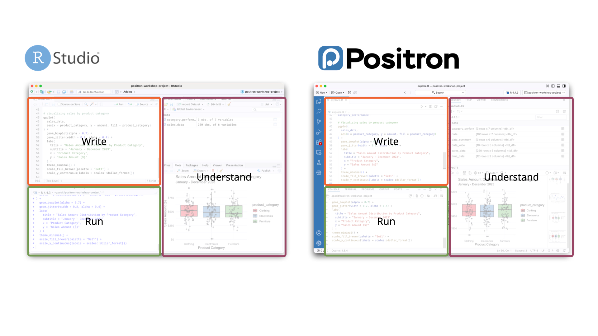
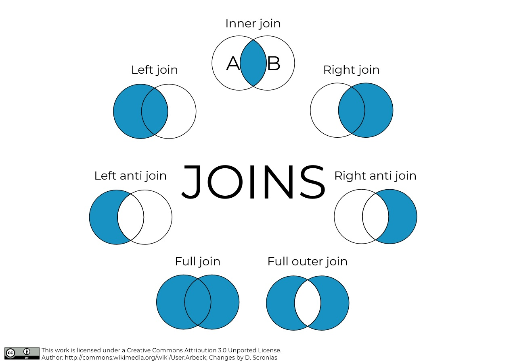

# Quarto

Quarto enables you to weave together content and executable code into a finished document. To learn more about Quarto see <https://quarto.org>. Quarto documents are **notebooks** written in **Markdown**, a markup language that is easy to use. You can check the syntax [here](https://www.markdownguide.org/basic-syntax/).

On the bar above (or Ctrl + Shift + F4 in Positron), you can switch between **Visual** and **Source**. Visual shows you a formatted output. Source shows you the raw file with the Markdown syntax.

## Running Code

When you click the **Render** button a document will be generated that includes both content and the output of embedded code. Below is a **code chunk**. You can execute it by pressing the little green arrow -\> on the right side of the chunk.

```{r}
1 + 1
```

There are two ways to show the output of a code: below the chunk (inline) or in the console (the tab below, with the `>`). To change between one and the other, click on the cog, next to the `Render` button, and click on either `Chunk Output in line` or `Chunk Output in console`

There are multiple ways to add a new chunk of code:

- `+C` icon on the upper bar of this window

- **Ctrl+Alt+i** (***Command*** if you are on Mac) shortcut

- Write **\`\`\`{r}** and press Enter.

*Add a new code chunk below*:

You can add options to executable code like this.

```{r}
#| echo: false
2 * 2
```

The `echo: false` option disables the printing of code (only output is displayed) when rendering the Quarto document.

## Stop using notebooks everywhere

Now that you know what a notebook is: stop using it EVERYWHERE. Notebooks are fine for exploration and interactive presentations. It's fine too for homework.

Never do full projects on notebooks. Use plain codes instead (.r files, .py for Python): these are more flexible and easier to call when creating **pipelines** and reusable functions.

::: callout-note
## Pipelines

A pipeline is the programming workflow from when you gather/import your data to the analytics/results. It can be one single file (not necessarily a good practice), or multiple individual files that you call.
:::

# R

## Layout



The space you are currently reading is called the **source**. Below, you can find the **console**. On the upper right side, this is the **environment**. Lower right side: **explorer**.

- **Source**: this is where you write your code. Save it in a file.

- **Console**: code gets executed there. You can directly write code in the console, but it is executed only once and**is not saved.**

- **Environment**: objects are saved there.

- **Explorer**: your computer storage (like any explorer) and your plots.

## Objects

An **object** refers to anything that exists (in memory) in R. It can be models, tables, numbers, characters, images...\
Objects can be **assigned** (bound to a name) to retrieve it later in your code. Think of it as storing it. To do this, use the `<-` operator (called the assignment operator). You can use `=` but this can arguably be considered **bad practice**.

```{r}
first_object <- "object"
second_object = "object" # This is ugly
```

```{r}
"what"
```

*Execute the two chunks above. What is the difference between them?*

::: callout-note
## Bad practices

Good coding style is like correct punctuation: you can manage without it, butitsuremakesthingseasiertoread.

For R, use [this one](https://style.tidyverse.org/).
:::

## Functions, packages

A function is anything that happens in R. You can think of it as a sequence of steps to transform data.

- It has input(s), data that comes in

- And output(s), data that comes out

```{r}
my_function <- function(a, b) {
  a + b^2
}
```

*What are a and b? What does the function do?*

To call (= execute) a function, you juste write its name, put parenthesis, and specify the inputs.

```{r}
my_function(1, 2)
```

Create a function that divides two inputs.

```{r}
my_function_2 <- function(a, b) {

}
```

Use `my_function(3, 3)` and `8` as inputs in `my_function_2`.

```{r}

```

You won't be required to create functions in this class. You just need to understand what a function is. It makes some things go faster, though.

**Packages**

In R, there are packages. It is a library in which you find multiple functions, e.g. :

- dplyr package: `filter()`, `mutate()`, `select()`…

- stats: `lm()`, `t.test()`…

- And a lot of others

```{r}
library(tidyverse)
```

This adds the tidyverse package to your environment.

Let's work with data.

------------------------------------------------------------------------

## Importing

On your computer, data is usually stored in some kind of format: csv (comma-separated values), xlsx (Excel), sas7bdat (SAS file), .sav (SPSS file), .dat (Stata), .rds (R file format)...

You must import it in R, but the function will change depending on the format:

- CSV (most common): use read_csv() from readr package

- Data files exported from statistical softwares: check haven package

- Excel: read_xlsx from readxl

### A quick note about working directory

The working directory is the folder from which R will look for your files. To know what your active directory is, use `getwd()`.

```{r}
getwd()
```

Your active directory should end with "Class 1" for this exercise. If that is not the case, close RStudio (or Positron), and open the C1E1.qmd file directly. The working directory will automatically be set to the folder in which the file is.

### Back to importing

Use the `read_csv()` function to import the Sales 2015.csv file. Assign it to an object called `df`.

```{r}

```

To look at your data, you can click on it in the environment section, or just use the function `View()`

```{r}
View(df)
```

Spend a quick minute familiarizing yourself with the Data Viewer. Note that the one in Positron in better. What variables do you find in this data set? What can you guess from the column names?

### Data manipulation paradigms

In today’s (2024) R ecosystem, you have multiple families of packages and tools to manipulate data:

- “Base R” (R built-in functions for data manipulation): avoid it. Courses that teach this are a waste of time (in my opinion).

- The Tidyverse: what is currently mainly used by R practitioners. Reasonably fast and very easy to understand. This includes packages like dplyr, ggplot2, purrr… That’s what we will use.

- Data.table: Very fast and memory efficient, but for more experienced R users. I won't be showing it, but you should be aware of its existence in case you need it one day. The syntax is entirely different from the Tidyverse.

There are a few (specialized) others, like arrow, sparklyr, dbplyr that allow to interact with specific database management systems. This is out of scope for this course.

### Selecting variables, filtering data

Use the `select()` function to keep specific variables (= columns), filter to keep observations (rows), `filter_out` to drop observations.

In df :

- keep only the columns OrderDate, StockDate, OrderNumber (don't assign it)

- keep OrderQuantity \> 1

- filter out ProductKey == 332

```{r}
select(df, ...)
filter(df, ...)
filter_out(df, ...)
```

Note that, for filtering, you can use : `>`, `>=`, `<`, `<=`, `==` (equal to), `&` (and), `|` (or)... See a little list here: <https://dplyr.tidyverse.org/reference/filter.html#useful-filter-functions>

### Piping

Two kinds of pipes : `|>` (base R) and `%>%` (`magrittr`) RStudio shortcut: Ctrl + Shift + M for Windows, or Cmd + Shift + M for Mac. I personally use the `magrittr` one, because it offers more functionalities.

Extremely useful for chaining functions

`df %>% select(age, income) %>% filter(income > 15000)`

In human language: take object `df`, AND THEN (`%>%`) select columns age and income, AND THEN keep observations with income over 15,000

In `df` keep only the columns `OrderDate`, `StockDate`, `OrderNumber` (don't assign it) and then keep `OrderQuantity > 1`

```{r}
df %>% 
  select(...) %>% 
  filter(...)
```

What differences do you see, compared to the previous code chunk?

How would you write the same code without using pipes ?

```{r}

```

### Modifying columns

Use `mutate()` to modify or add new variables:

```{r}
df %>% 
  mutate(
    new_column = 1, # It's just a column of 1
    new_column_2 = rnorm(nrow(df), 145, 38),
    .before = OrderDate # .before and .after place the new columns at a specific location in your dataset, this is facultative, it is just so you can see the new columns more easily
  )
```

Find out what `nrow` do by typing `help(nrow)`. Do the same for `rnorm`. What is `new_column_2`?

Create a new column `total_cost` in `df`, by multiplying the order quantity and the product price.

```{r}
df <- 
```

### Summarizing and group_by

Summarise allows you to compute summaries of variables (e.g. means, medians, max, etc. etc.)

Look here for a bunch of useful functions to use with `summarise()` : <https://dplyr.tidyverse.org/reference/summarise.html#useful-functions>

```{r}
df %>% 
  summarise(
    number_of_rows = n()
  )
```

Compute the total cost of all orders.

```{r}

```

`group_by()` does the exact same, but by group. For example, here is the number of orders per Territory:

```{r}
df %>% 
  group_by(TerritoryKey) %>% 
  summarise(number_of_orders = n())
```

Find the highest-paying territory and filter out the others.

```{r}
df
```

### Data types

Objects are more complicated than it seems, but it is out of scope of this class. You can refer to Advanced R, by H. Wickham for more discussions about objects and objects-oriented programming.

Objects have a base type, that you can find with `typeof()`. Also, some objects have properties that you can find with `class()` (class attributes) and attributes, that you can find with `attributes()`.

What differences do you find when running `typeof()` and `class()` on `df`?

```{r}


```

`df` is a tibble, a specific kind of dataframe introduced by the Tidyverse ecosystem.

What interests us more is data types inside dataframes. If you just view a tibble, it will list the types of the columns it contains:

```{r}
df
```

What data types do you find in the `df` columns of `df`?

There are also many ways to find the types of a column :

```{r}
# One column (just different selection syntaxes)
typeof(df$OrderDate)
typeof(df %>% pull(OrderDate))
typeof(df[["OrderDate"]])

# All at once
map( # Map is a bit complex. Map applies a function to each element of a list. When given a dataframe, it will apply a function to each column.
  df,
  typeof
) 
```

`OrderDate` is stored as a character. This can work, but it is not optimal. There exists a date data type in R. Let's change it.

You know how to modify variables using `dplyr`. If you want to change `OrderDate` to a date, you would need to use:

`as_date(OrderDate, format = "%m/%d/%Y")`

Why `%m/%d/%Y`? This will work here in THIS particular case. `%m` refers to month, `%d` refers to day, and `%Y` refers to year (in YYYY format). In another dataset, you might have something different, such as `%m-%d-%Y`. Or `%d/%m/%y` (`%y` is year in YY format).

Modify `df` such at `OrderDate` becomes a `date`. Don't forget the function we saw earlier to modify a dataframe!

```{r}
# OrderDate = as_date(OrderDate, format = "%m/%d/%Y")
```

Run this obscure code. What do you find inside `df_dates`?

```{r}
df_dates <- 
  map(
    seq_len(1000),
    ~ paste(
        round(runif(10, 1, 28)),
        round(runif(10, 1, 12)),
        round(runif(10, 2013, 2024)),
        sep = "-"
    )
  ) %>% 
    set_names(paste("Date_", seq_len(1000), sep = "")) %>% 
    as_tibble()
```

All of these are dates entered as strings, like `OrderDate`. We have 1000 of these columns, we all want these to become dates. One way to do it would be to modify them one by one (or change the code above, but it is cheating and I don't want you to cheat.)

There are multiple ways to do this. If you have a quick idea of one, put it here:

```{r}

```

------------------------------------------------------------------------

------------------------------------------------------------------------

------------------------------------------------------------------------

------------------------------------------------------------------------

------------------------------------------------------------------------

------------------------------------------------------------------------

------------------------------------------------------------------------

------------------------------------------------------------------------

------------------------------------------------------------------------

------------------------------------------------------------------------

------------------------------------------------------------------------

------------------------------------------------------------------------

------------------------------------------------------------------------

------------------------------------------------------------------------

------------------------------------------------------------------------

------------------------------------------------------------------------

------------------------------------------------------------------------

------------------------------------------------------------------------

------------------------------------------------------------------------

------------------------------------------------------------------------

------------------------------------------------------------------------

------------------------------------------------------------------------

------------------------------------------------------------------------

------------------------------------------------------------------------

------------------------------------------------------------------------

------------------------------------------------------------------------

------------------------------------------------------------------------

------------------------------------------------------------------------

------------------------------------------------------------------------

------------------------------------------------------------------------

------------------------------------------------------------------------

------------------------------------------------------------------------

------------------------------------------------------------------------

------------------------------------------------------------------------

Dplyr allows to modify multiple variables at once quickly, using the function across().

```{r}
# df_dates <- 
#   df_dates %>% 
#   mutate(
#     across(
#       .cols = starts_with("Date"),
#       .fns = ~ as_date(.x, format = "%d-%m-%Y")
#     )
#   )
```

Look at the new functions you do not know (yet) : across() and starts_with(). What do you think these do? What do the arguments .cols and .fns refer to?

Finally, there is a "\~", just after the .fns arguments. What do you think these do?

These are more advanced concepts (especially \~) that you should come back to after some more experience with R. I think early exposure to more complex programming concepts is worth your time.

### Joins

VERY IMPORTANT to know. Joins are used to combine tables together. You need to know this by heart, it's a must-have skill.

To perform a join, you need two tables. These tables need to have one or more common variables ("keys") in order to know which observations to match. Note this is different from simply binding columns together: observations are joined based on one or more common columns.



There is a page on the dplyr package about joins : <https://dplyr.tidyverse.org/reference/mutate-joins.html>.

Import the dataframe "Customers.csv". Check its number of rows.

```{r}
customers <-
```

Using `left_join()`, join the customers table to df. How many rows are there?

```{r}
joined_tables <-
    df %>%
```

Do the same thing, but starting from the customers table. How many rows are there?

```{r}
customers %>% 

```

Why is there a difference in the number of rows?

Starting from the `df` table, join the customers table such that you get all the observations from both tables.

```{r}
df %>% 
```

#### AI integration

With Positron, you can use the "Posit Assistant" to call a LLM (using an API key) that will have access to your environment and that can run code.

Claude is recommended, but the free version does not allow you to get an API key. You need to pay either way. Google AI Studio offers a free tier with an API key that you can use with the Posit Assistant (which is what I use).

# Other resources

R for Data Science: https://r4ds.hadley.nz/ Advanced R: https://adv-r.hadley.nz/index.html