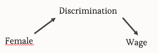
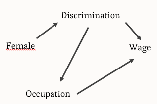
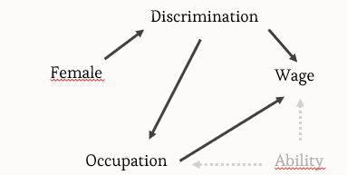
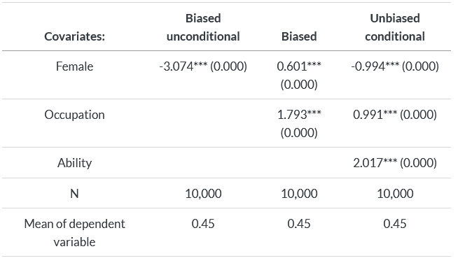

# Collider bias

This is an example taken from Scott Cunningham's Causal Inference: The Mixtape to introduce collider bias.


Import these packages.

```{r}
library(tidyverse)
library(broom)
library(stargazer)
```

## Data generating process

```{r}
set.seed(1000)
n <- 10000
```

**What does the `set.seed` function do?** Type `help(set.seed)` if you don't know, or search online.

```{r}
tb <- tibble(
  female = ifelse(runif(10000) >= 0.5, 1, 0),
  ability = rnorm(10000),
  discrimination = female,  # Discrimination linked to being female
  occupation = 1 + 2 * ability - 2 * discrimination + rnorm(10000),
  wage = 1 - discrimination + occupation + 2 * ability + rnorm(10000)
)
tb
```

The code above created a new dataset using simulated data.

- What is `female`? How is it created?

- What is `ability`? How is it created?

- What is `discrimination`? How is it created? What are the assumptions behind this variable, in the context of this simulation?

- What is `occupation`? How is it created? What is the impact of `ability` on `occupation`? And `discrimination` on `occupation`?

- What is wage? How is it created? What is the impact of `discrimination` on `wage`? `Occupation`? `Ability`?

## Regression 1 - `wage` and `female`

Using a linear model (you can use `lm()`), regress `wage` onto `female`

```{r}
lm_1 <- 
```



The `tidy()` function from the `broom` package lets you have your regression results in a formatted tibble. It is very flexible. You can add confidence intervals using the `conf.int` argument. I will always suggest you use confidence intervals instead of p-values (and stop using p-values altogether).

```{r}
tidy(lm_1, conf.int = TRUE)
```

- What is the coefficient of `Intercept`? What does it mean?
- What is the coefficient of `female`? What does it mean?
- Is the coefficient of female what you expected?
- Would you say the coefficient of female is biased, here?

::: callout-note
## What is behind the -3 coefficient?

Coefficient is -3 because you get the **total effect** of being `female` on `wage`

- -1 is the **direct effect** of `discrimination` on `wage`

- -2 is the **indirect effect** of `discrimination` on `wage`, through `occupation` (since `discrimination` also affects `occupation` which affects `wage`)
:::

## Regression 2 - `wage`, `female`, `occupation`

Now, add `occupation` in your regression.

```{r}
lm_2 <- 
```



```{r}
tidy(lm_2, conf.int = TRUE)
```

- What is the coefficient of `Intercept`? What does it mean?
- What is the coefficient of `occupation`? What does it mean?
- What is the coefficient of `female`? What does it mean?
- Is the coefficient of female what you expected? **Why is it positive?**
- Would you say the coefficient of female is biased, here?

## Regression 3 - `wage`, `female`, `occupation` and `ability`

```{r}
lm_3 <-
```



```{r}
tidy(lm_3, conf.int = TRUE)
```

- What is the coefficient of `Intercept`? What does it mean?
- What is the coefficient of `occupation`? What does it mean?
- What is the coefficient of `female`? What does it mean?
- What is the coefficient of `ability`? What does it mean?
- Why do we find the true coefficient of `female`, compared to the previous regression?

::: callout-note
## Backdoor paths

Backdoor paths represent spurious associations between an explanatory variable and a dependent variable when not controlling (counfounder bias) or when controlling for (collider bias) a third one.

Here, including `occupation` opened a backdoor path between `ability` and `wage`. The effect of `ability` on `wage` is introduced because `ability` influences `occupation`.

Ability varies, but the model does not account for it since we did not include it in the second equation, so the total effect of ability on wage is reflected in the other coefficients of the model. They become **biased**.
:::

## Final table

```{r}
stargazer(lm_1, lm_2, lm_3, type = "text",
          column.labels = c("Unconditional (Biased)", 
                            "Conditional (Biased)", 
                            "Fully Conditional (Unbiased)"),
          dep.var.caption = "Dependent variable: Wage",
          omit.stat = c("f", "ser")) 
```

