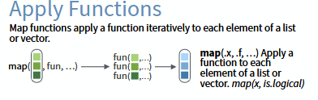
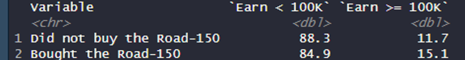

{width="260"}

This exercise is not complicated and involves basic data management functions you should know (if you are looking to work in data science) and be able to use without the help of an LLM.

If you don't know how to use a function, look for it yourself in the documentation.

## Dataset

Data comes from AdventureWorks, a sample of a database made by Microsoft used for training to design SQL server databases, using data from the Adventure Works brand.

There are 10 tables in the database:

- Calendar: with a range of dates

- Customers: customer data, with their name, income, number of children, education level…

- Products

  - Main table: information about products sold by AdventureWorks, name of product, cost, color, price

  - Subcategories: categories of products

  - Categories: categories of products

- Returns: returned products

- Sales (2015, 2016 and 2017): sales with the information about the product, customer who bought it, how many, date and where it was bought

- Territories: information about geographical locations (region, country, continent)

## Imports

```{r}
library(tidyverse)
```

## Question 1

Import all the .csv tables and have a look at the data

::: callout-warning
## `read.csv()` and `read_csv()`

In programming, you will often find multiple ways (or functions) to achieve the same goal. `read.csv()` and `read_csv()` both import .csv files. **However, they do not return the same object!**

`read.csv()` is "base" R (native R), while `read_csv()` is from the Tidyverse package.

I advise you to use Tidyverse functions instead of base R.
:::

```{r}
df_calendar <- read_csv("AdventureWorks_Calendar.csv")
df_customers <- read_csv("AdventureWorks_Customers.csv", locale = locale(encoding = "latin1"))
df_product_categories <- read_csv("AdventureWorks_Product_Categories.csv")
df_product_subcategories <- read_csv("AdventureWorks_Product_Subcategories.csv")
df_products <- read_csv("AdventureWorks_Products.csv")
df_returns <- read_csv("AdventureWorks_Returns.csv")
df_sales_2015 <- read_csv("AdventureWorks_Sales_2015.csv")
df_sales_2016 <- read_csv("AdventureWorks_Sales_2016.csv")
df_sales_2017 <- read_csv("AdventureWorks_Sales_2017.csv")
df_territories <- read_csv("AdventureWorks_Territories.csv")
```

How many rows and columns are in each table?

```{r}

```

### Data cleaning section

Cleaning individual dataframes should be done first. If at a later question you need to modify data inside one of the dataframes you just imported, come back here.

Your code should **always** be structured so that modifications to your imported datasets are at the beginning.

```{r}
nrow(df_calendar)
ncol(df_calendar)

df_calendar <-
  df_calendar %>%
  mutate(
    Date = as_date(Date, format = "%m/%d/%Y"),
    Year = year(Date),
    Month = month(Date),
    Day = day(Date),
    weekday = case_when(
      weekdays(Date) == "lundi" ~ "Monday",
      weekdays(Date) == "mardi" ~ "Tuesday",
      weekdays(Date) == "mercredi" ~ "Wednesday",
      weekdays(Date) == "jeudi" ~ "Thursday",
      weekdays(Date) == "vendredi" ~ "Friday",
      weekdays(Date) == "samedi" ~ "Saturday",
      weekdays(Date) == "dimanche" ~ "Sunday"
    )
  )

df_customers <-
  df_customers %>%
  mutate(
    AnnualIncome_num =
      AnnualIncome %>%
      str_remove_all("\\$") %>%
      str_remove_all(",") %>%
      as.numeric()
  )
```

### Advanced facultative question

Use the `map()` function to import all .csv at once.



You need to identify: what function you need to use (inside `map()`), and to what elements this function should apply.

```{r}
df <-
  # Map is a function that allows to repeat the same function over a list
  # https://purrr.tidyverse.org/reference/map.html
  map(
    # list.files() gives you all the files in the working directory, keep() keeps
    # strings in a list that satisfy some condition (here, all files that end with .csv)
    list.files() %>% keep(., ~ str_ends(.x, ".csv")),
    # ~ is an anonymous (or "lambda") functions: https://adv-r.hadley.nz/functionals.html?q=anonymous#purrr-shortcuts
    # Basically, ~ means that you create a function here that is not named, not saved in an object, and is only used once
    # Inputs are written: .x, .y...
    ~ read_csv(.x)
  ) %>%
  # This changes the names of the data.tables inside the object df
  # So they will be called "Calendar", "Customers", "Product_Categories", etc. etc.
  set_names(
    list.files() %>% keep(., ~ str_ends(.x, ".csv")) %>%
      str_remove_all("AdventureWorks_") %>%
      str_remove_all(".csv")
  )
```

## Question 2

There are three sales tables. Bind them all into one table. Call it `sales_all`.

```{r}
df_sales_all <- bind_rows(
  df_sales_2015,
  df_sales_2016,
  df_sales_2017
)
```

How many orders have been made over those three years?

```{r}
nrow(df_sales_all)
```

## Question 3

Merge the three products tables: products, products_categories and products_subcategories. What key(s) did you use to join the tables?

```{r}
df_products_all <-
  df_products %>% 
  left_join(
    df_product_subcategories,
    by = "ProductSubcategoryKey" # Ideally, specify this!
  ) %>% 
  left_join(df_product_categories)
```

## Question 4

Starting from `sales_all`, join it to your new products table (df_products_all), with the customers table, and the territories table.

```{r}
df_customers #Quick look at the df
colnames(df_customers) # List of variables

df_sales_prod_cust <- 
  df_sales_all %>% 
  left_join(
    df_products_all,  by = "ProductKey"
  ) %>% 
  left_join(
    df_customers, by = "CustomerKey"
  ) %>% 
  left_join(
    df_territories,
    by = c("TerritoryKey" = "SalesTerritoryKey")
  )
```

How many rows are there? Why do you think the tables were split up in the first place?

```{r}
nrow(df_sales_prod_cust)
```

## Question 5

Starting from the customers table, left join it to the sales tables, the territories table, and the products table.

```{r}
df_customers %>% 
  left_join(
    df_sales_all, by = "CustomerKey"
  ) %>% 
  left_join(
    df_products_all,  by = "ProductKey"
  ) %>% 
  left_join(
    df_territories,
    by = c("TerritoryKey" = "SalesTerritoryKey")
  )
```

How many rows are there?

```{r}
df_customers %>% 
  left_join(
    df_sales_all, by = "CustomerKey"
  ) %>% 
  left_join(
    df_products_all,  by = "ProductKey"
  ) %>% 
  left_join(
    df_territories,
    by = c("TerritoryKey" = "SalesTerritoryKey")
  ) %>%
  nrow()
```

Why is it different from the number of rows you had in the table from the previous question?

> Some customers have never placed any order. If you start left joining other tables to the customers table, you will keep them. If you left join the other tables starting from the sales table, you will not keep the customers who ahve never placed an order.

What would you change or do to get the same number of rows?

> Use a full join.

```{r}
df_sales_all %>% 
  full_join(
    df_products_all,  by = "ProductKey"
  ) %>% 
  full_join(
    df_customers, by = "CustomerKey"
  ) %>% 
  full_join(
    df_territories,
    by = c("TerritoryKey" = "SalesTerritoryKey")
  )
```

## Question 6

How many customers earn over \$100,000? On which table should you check this?

```{r}
df_customers %>% 
  mutate(
    AnnualIncome_num = 
      AnnualIncome %>% 
      str_remove("\\$") %>%
      str_remove(",") %>% 
      as.numeric()
  ) %>% 
  filter(AnnualIncome_num > 100000) %>% View()
```

## Question 7

Is there missing data in the Customers table? How many rows have missing data? In which variable(s)?

```{r}
# Part of the answer : is.na(AnnualIncome)
colSums(is.na(df_customers))

df_customers %>% 
  filter(
    is.na(CustomerKey) | is.na(Prefix) | is.na(FirstName) |
      is.na(LastName) |
      is.na(BirthDate) | is.na(MaritalStatus) |
      is.na(Gender) | is.na(EmailAddress) |
      is.na(AnnualIncome) | is.na(TotalChildren) |
      is.na(EducationLevel) | is.na(Occupation) |
      is.na(HomeOwner)
  )

# Advanced alternative
df_customers %>%
  filter(
    if_any(
      # if_any needs: a list of columns, a function
      .cols = everything(), # Here you put the columns on which you want to apply the function below
      .fn = ~ is.na(.x) # Here, a function that specifies the condition to keep observations
    )
  )
```

## Question 8

How many orders have been made from people with income over \$100,000?

```{r}
df_sales_prod_cust %>% 
  filter(AnnualIncome_num > 100000)
```

## Question 9

What is the average price of products bought by people with an income over \$100,000? Under \$100,000?

```{r}
avg_price_by_incgrp <- 
  df_sales_prod_cust %>%
  mutate(
    over100k = case_when(AnnualIncome_num >= 100000 ~ "Yes", .default = "No"),
    total_order_price = OrderQuantity * ProductPrice # Note: one row can contain multiple bought items!
  ) %>%
  group_by(over100k) %>% # This allows to compute statistics over groups
  # So here, you will get the n, mean product price, and sd of product price
  # for each group in the variable "over100k)
  summarise(
    n = n(),
    avg_price = mean(total_order_price),
    sd_price = sd(total_order_price)
  )
```

Calculate the 95% confidence interval of these averages.

::: callout-tip
## 95% CI formula

$\overline{price} \pm 1.96*\frac{\sigma_{price}}{\sqrt{n}}$
:::

```{r}
avg_price_by_incgrp %>%
  mutate(
    up_ci = avg_price + 1.96 * (sd_price/sqrt(n)),
    low_ci = avg_price - 1.96 * (sd_price/sqrt(n)),
  )
```

Now do a t-test of difference in means using the `t.test()` function.

```{r}
df_ttest <-
  df_sales_prod_cust %>%
  mutate(
    over100k = case_when(AnnualIncome_num >= 100000 ~ "Yes", .default = "No"),
    total_order_price = OrderQuantity * ProductPrice
  ) %>%
  select(total_order_price, over100k)

# The t.test function require two vectors of numerical data, but right now our data is in a table (df_ttest)
# Since we want to compare those that earn more than 100k to those that earn less
# We need to filter them in our df_ttest object, and then pull the order price column
t.test(
  x = df_ttest %>% filter(over100k == "Yes") %>% pull(total_order_price),
  y = df_ttest %>% filter(over100k == "No") %>% pull(total_order_price)
)
```

## Question 10

Do a histogram of the distribution of prices of the models sold by Adventure Works. Use `ggplot()`.

```{r}
df_products %>%
  distinct(ModelName, ProductPrice) %>%
  ggplot(
    aes(x = ProductPrice)
  ) +
  geom_histogram()
```

## Question 11

What is the most expensive bike sold by the company? Among all customers, how many bought it? Give the number and the percentage.

```{r}
most_expensive_bike <-
  df_products %>%
  filter(ProductPrice == max(ProductPrice)) %>%
  distinct(ModelName) %>%
  pull()
most_expensive_bike # I stored the name of the most expensive bike in an object

purchased_most_expensive_bike <-
  df_sales_prod_cust %>%
  # Note here: I call in the filter function the object I created just before, instead of writing "Road-150"
  # This way of doing things is nice if you want to automate your code: imagine you had a newer version of the database
  # with new products etc. etc., maybe the name of the most expensive product would have changed
  # With the way this is done here, the name of the most expensive product would be updated automatically
  filter(ModelName == most_expensive_bike) %>%
  distinct(CustomerKey)


df_most_expensive <-
  df_customers %>%
  mutate(
    over100k = case_when(
      AnnualIncome_num >= 100000 ~ "Yes",
      .default = "No"),

    # What this does:
    # Look at every CustomerKey in the dataframe customers,
    # If it is contained in the dataframe we created in the previous step (those that bought the most expensive bike)
    # Then bought_most_expensive takes the value "Yes"
    bought_most_expensive = case_when(
      CustomerKey %in% purchased_most_expensive_bike$CustomerKey ~ "Yes",
      .default = "No"
    )
  ) %>%
  select(over100k, bought_most_expensive)

# How many bought the bike? In Prct?
df_most_expensive %>%
  count(bought_most_expensive) %>%
  mutate(prct = n/sum(n)*100)
```

## Question 12

Are there more high-earners who bought the most expensive bike, compared to lower-earners? Do a two-way table, using R (not Excel!), in this format:



The earnings variable should be in column, the binary variable indicating if the customer bought the most expensive bike in row, and row percentages should be shown (row percentages means that the percentages in a row should sum to 100)

```{r}
tw_table <-
  df_most_expensive %>%
  count(over100k, bought_most_expensive) %>%
  group_by(bought_most_expensive) %>%
  mutate(
    prct_row = n/sum(n) * 100
  ) %>%
  pivot_wider(
    names_from = over100k,
    values_from = c("n", "prct_row")
  ) %>%
  select(Variable = bought_most_expensive, `Earn < 100K` = prct_row_No, `Earn >= 100K` = prct_row_Yes) %>%
  mutate(Variable = case_when(
    Variable == "No" ~ "Did not buy the Road-150",
    Variable == "Yes" ~ "Bought the Road-150"
  ))
tw_table
```

## Question 13

Export this table to a .csv (or .xlsx) file.

```{r}
tw_table %>% write_csv("test.csv") # This saves the table we just created to a csv file
```

## Question 14

Do a chi-squared test of independence to check if there is an association between high earnings and buying the most expensive bike.

```{r}
table(df_most_expensive$over100k, df_most_expensive$bought_most_expensive) %>%
  chisq.test()
```